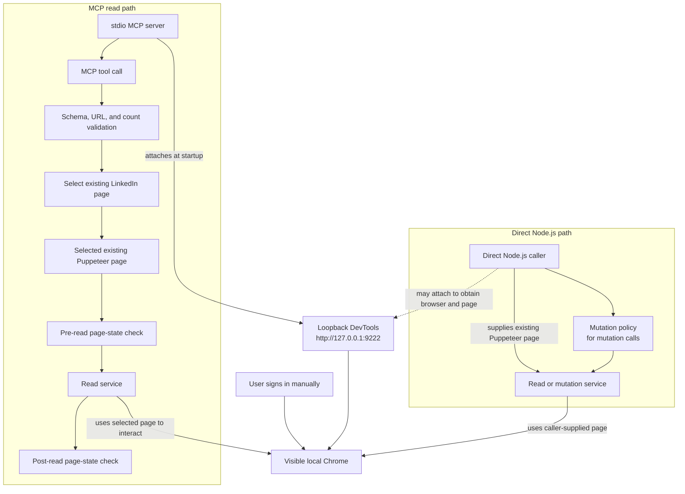

# Runtime architecture

Linkout attaches to a Chrome process that the user starts and signs in to manually. Chrome owns the LinkedIn session; Linkout does not create or import it.

The default connection path is local: `connectLocalChrome()` accepts an HTTP DevTools endpoint, requires a loopback host unless a direct Node.js caller sets `allowRemote: true`, and connects with `defaultViewport: null`. The packaged MCP server reads `LINKOUT_CHROME_URL` and otherwise uses `http://127.0.0.1:9222`. Remote DevTools is not part of the documented workflow.

The MCP server attaches to Chrome at startup. Each valid tool call selects an existing page whose hostname is exactly `www.linkedin.com`; neither the server nor the service creates a LinkedIn tab. Its schemas validate URI syntax and integer count bounds. Handler checks restrict URLs to HTTPS `www.linkedin.com` paths, strip query strings and fragments, and enforce counts from `0` through `100`. The handler checks page state before and after calling the read service with the selected page.

Direct Node.js services operate on the existing Puppeteer `page` supplied by the caller. They bypass MCP schema, URL and count validation, MCP response envelopes, and the MCP before-and-after read checks. The action policy belongs to direct mutation services; the MCP surface exposes only reads.

## Trust boundary

- Chrome retains the signed-in session and browser profile.
- Linkout attaches through DevTools and drives the selected page. A local process with access to the DevTools port is therefore inside the browser-control boundary.
- The standard detector stops on login, checkpoint, CAPTCHA, automated-activity warning or restriction, unexpected modal, and unknown state. Page text, URLs, and selectors determine that classification.
- Direct mutation services use the action policy and interaction checks by default. Operations are disabled by default, but a caller can provide policy configuration and injectable policy or interaction components.
- Policy confirmation is a value supplied by the caller, not proof that a person reviewed the action. The raw policy uses truthiness; service handling differs by operation.
- A direct caller can omit MCP validation, replace the policy detector, or otherwise call lower-level exports. These controls are defaults and checks in this runtime, not an unbypassable security boundary.

Linkout has no credential-submission, cookie-injection, session-token, or OTP workflow. It does not use proxies, does not default to remote DevTools, and rejects the `fingerprint`, `userAgent`, `locale`, `timezone`, and `viewport` connection options. Authentication and security prompts remain manual.

## Repository and runtime structure

| Path | Responsibility |
| --- | --- |
| `bin/linkout-mcp.js` | Packaged stdio MCP entry point |
| `lib/mcp/` | Tool schemas, handlers, and server startup |
| `lib/browser/` | Chrome endpoint validation and page-state detection |
| `lib/linkedin/` | Read and mutation services |
| `lib/interactions/` | Click, typing, timing, and interaction stop checks |
| `lib/policy/` | Mutation defaults, gates, and ledgers |
| `lib/selectors/` | Read and action selectors |
| `lib/linkedin.service.js` | CommonJS `services` and `tools` exports |
| `.mcp.json`, `.claude-plugin/`, `.codex-plugin/` | MCP and plugin manifests |

Source: [Chrome connection](https://github.com/linkoutapp/linkout-scraper/blob/main/lib/browser/connect-local-chrome.js), [page-state detector](https://github.com/linkoutapp/linkout-scraper/blob/main/lib/browser/detect-page-state.js), [MCP server](https://github.com/linkoutapp/linkout-scraper/blob/main/lib/mcp/server.js), [MCP handlers](https://github.com/linkoutapp/linkout-scraper/blob/main/lib/mcp/handlers.js), [action policy](https://github.com/linkoutapp/linkout-scraper/blob/main/lib/policy/action-policy.js).
